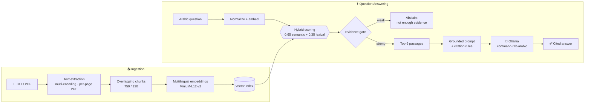

<div align="center">


# APEX
### Government Services AI

**Ask in Arabic. Get answers grounded in the official document, with the source cited.**

<br/>


[Accuracy by Design](#-accuracy-by-design) · [Architecture](#-architecture) · [Tech Stack](#-tech-stack) · [Quick Start](#-quick-start) · [Configuration](#-configuration)

</div>

---

## 🏛️ Why APEX

Government procedures are full of details that can't be approximated: **fees, deadlines, required documents, eligibility conditions.** A confident but wrong answer is worse than no answer.

APEX is a **Retrieval-Augmented Generation (RAG)** assistant built around that principle. It searches your official documents first, hands only the matching passages to a local Arabic language model, and requires every claim in the answer to point back to its source. When the documents don't contain enough evidence, APEX says so instead of guessing.

> **Your documents never leave your machine.** Embeddings, retrieval and generation all run locally. No cloud API, no API keys.

---

## ✨ Features

<table>
<tr>
<td width="50%">

### 🔎 Hybrid Retrieval
Semantic understanding **and** exact keyword matching, fused into a single relevance score.

</td>
<td width="50%">

### 🇸🇦 Arabic-Native Search
Diacritics, tatweel, and letter variants (`أ إ آ ٱ` / `ى`) are normalized, so spelling differences don't break retrieval.

</td>
</tr>
<tr>
<td>

### 📎 Cited Answers
Every fact carries a `[S1]`, `[S2]`… tag tied to the exact passage and document that supports it.

</td>
<td>

### 🛡️ Evidence Gate
Weak evidence means no answer. APEX abstains rather than inventing fees, durations, or requirements.

</td>
</tr>
<tr>
<td>

### 📄 Multi-Document
Upload several TXT and PDF files at once and query across all of them.

</td>
<td>

### 🔬 Fully Transparent
Inspect every retrieved passage with its semantic, keyword, and final scores.

</td>
</tr>
</table>

---

## 🎯 Accuracy by Design

APEX layers multiple safeguards so that answers stay faithful to the source documents. Each one is implemented in the pipeline:

| # | Safeguard | What it does |
|:-:|---|---|
| **1** | **Hybrid scoring** | `0.65 × semantic + 0.35 × lexical`. Semantic similarity catches paraphrases ("what do I need to bring?" ↔ "required documents"); keyword overlap locks onto exact terms like service names, form names, and figures. |
| **2** | **Arabic normalization** | NFKC unification, diacritics and tatweel removal, and alef/ya variant folding applied to both queries and documents before matching. |
| **3** | **Overlapping chunks** | 750-character windows with a 120-character overlap, so a condition split across a boundary is still retrieved intact. |
| **4** | **Evidence gate** | If the best passage has weak semantic similarity **and** zero keyword matches, APEX declines to answer instead of improvising. |
| **5** | **Duplicate filtering** | Identical passages are removed so the model's limited context holds diverse evidence. |
| **6** | **Strict grounding prompt** | The model must answer from the retrieved passages only, never invent fees, conditions, durations, or documents, and must state when information is missing or unclear. |
| **7** | **Conflict handling** | If two documents disagree, the answer explains the difference rather than silently picking one. |
| **8** | **Mandatory vs. optional** | The model is instructed to distinguish required conditions from optional information, which matters for eligibility and documents-needed questions. |
| **9** | **Per-claim citations** | Each supported statement is tagged `[S#]`, and the model is told never to attribute a claim to a source that doesn't contain it. |
| **10** | **Prompt-injection resistance** | Text inside documents is treated as content to analyze, never as commands to obey. |
| **11** | **Low-temperature decoding** | `temperature = 0.1` for consistent, factual output. |
| **12** | **Inspectable evidence** | Retrieved passages and all three scores are shown in the UI, so any answer can be verified in seconds. |

---

## 🏗️ Architecture



---

## 🧱 Tech Stack

| Layer | Technology | Role |
|---|---|---|
| **Interface** | [Streamlit](https://streamlit.io) | Upload, question form, results and evidence viewer |
| **Language Model** | [Ollama](https://ollama.com) · `command-r7b-arabic:7b` | Local Arabic answer generation |
| **Embeddings** | [Sentence-Transformers](https://www.sbert.net) · `paraphrase-multilingual-MiniLM-L12-v2` | Multilingual semantic vectors, running on CPU |
| **Vector Math** | [NumPy](https://numpy.org) | Cosine similarity over normalized embeddings |
| **Document Parsing** | [pypdf](https://pypdf.readthedocs.io) | Page-by-page PDF text extraction |
| **Connectivity** | [requests](https://requests.readthedocs.io) | Local Ollama chat API |
| **Retrieval Engine** | Custom hybrid scorer | Semantic + Arabic-normalized keyword fusion |

---

## 🚀 Quick Start

**Prerequisites:** Python 3.10+ and [Ollama](https://ollama.com/download) installed.

```bash
# 1. Clone and enter the project
git clone <your-repo-url>
cd <your-repo-folder>

# 2. Create a virtual environment
python -m venv .venv
source .venv/bin/activate          # Windows: .venv\Scripts\activate

# 3. Install dependencies
pip install -r requirements.txt

# 4. Download the Arabic model
ollama pull command-r7b-arabic:7b

# 5. Launch APEX
streamlit run app.py
```

Open the URL Streamlit prints (usually `http://localhost:8501`).

> 💡 The first launch downloads the embedding model once; after that, everything runs offline.

---

## 🖱️ Usage

1. **Upload** one or more official documents (`.txt` or `.pdf`).
2. Wait for the **indexing confirmation**.
3. **Ask in Arabic**, for example:

   > ما الوثائق المطلوبة للحصول على الخدمة؟

4. Press **ابحث وأجب** (Search & Answer).
5. Read the **cited answer**, then expand **المقاطع المسترجعة ودرجاتها** to inspect the evidence behind it.

---

## ⚙️ Configuration

Tune APEX from the constants at the top of `app.py`:

| Setting | Default | Purpose |
|---|---|---|
| `OLLAMA_MODEL` | `command-r7b-arabic:7b` | Generation model |
| `OLLAMA_URL` | `http://localhost:11434/api/chat` | Ollama endpoint |
| `EMBEDDING_MODEL` | `paraphrase-multilingual-MiniLM-L12-v2` | Embedding model |
| `CHUNK_SIZE` | `750` | Characters per chunk |
| `CHUNK_OVERLAP` | `120` | Overlap between neighboring chunks |
| `TOP_K` | `5` | Passages sent to the model |

Generation runs with `temperature = 0.1` and a `4096`-token context window.

---

## 📁 Project Structure

```
.
├── app.py              # Ingestion, hybrid retrieval, grounded generation, UI
├── apex.png            # Brand banner
├── requirements.txt    # Dependencies
├── .gitignore
└── README.md
```

---

## 🧰 Troubleshooting

| Symptom | Fix |
|---|---|
| Can't connect to Ollama | Make sure the Ollama app/service is running |
| Model not found | Run `ollama pull command-r7b-arabic:7b` |
| Request timed out | Use a smaller model, or lower `TOP_K` |
| No extractable text in a PDF | The PDF is image-based; run OCR on it before uploading |
| "Not enough evidence" message | Rephrase the question, or upload the document that covers it |

---


---

<div align="center">

### APEX
**Precise. Private. Provable.**

</div>
