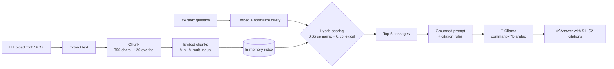

<div align="center">


# APEX | Government Services AI

**A local, Arabic-first RAG assistant that answers questions about government services, grounded strictly in your documents.**


</div>

---

## ✨ Overview

**APEX** lets citizens and staff upload official government documents (TXT or PDF) and ask questions about them in Arabic. Instead of letting the model answer from memory, APEX **retrieves the most relevant passages first** and forces the model to answer **only from that evidence**, with a citation (`[S1]`, `[S2]`, …) next to every claim.

Everything runs on your own machine: documents never leave your computer, and no cloud API is needed.

### Highlights

| | Feature | Details |
|---|---|---|
| 🔎 | **Hybrid retrieval** | Combines semantic similarity (65%) with exact keyword overlap (35%) |
| 🇸🇦 | **Arabic-aware search** | Normalizes diacritics, tatweel, and letter variants before matching |
| 📎 | **Cited answers** | Every fact is tagged with its source passage |
| 🛡️ | **Hallucination guardrails** | Refuses to answer when the documents give weak evidence |
| 📄 | **TXT + PDF support** | Multi-file upload, multiple Arabic text encodings handled |
| 🔒 | **Fully local** | Local embeddings + local LLM via Ollama |

---

## 🧱 Tech Stack

| Layer | Technology | Role in APEX |
|---|---|---|
| **Interface** | [Streamlit](https://streamlit.io) | Web UI: file upload, question form, results |
| **LLM** | [Ollama](https://ollama.com) · `command-r7b-arabic:7b` | Local Arabic answer generation |
| **Embeddings** | [Sentence-Transformers](https://www.sbert.net) · `paraphrase-multilingual-MiniLM-L12-v2` | Multilingual semantic vectors (CPU) |
| **Vector math** | [NumPy](https://numpy.org) | Cosine similarity via dot product of normalized vectors |
| **Document parsing** | [pypdf](https://pypdf.readthedocs.io) | Text extraction from PDF files |
| **HTTP client** | [requests](https://requests.readthedocs.io) | Calls the local Ollama chat endpoint |
| **Retrieval** | Custom hybrid scorer | Semantic score + Arabic-normalized lexical overlap |

---

## 🏗️ How It Works



### Pipeline in detail

1. **Ingestion**: TXT files are decoded by trying `utf-8-sig`, `utf-8`, then `cp1256`. PDFs are read page by page with `pypdf`, and each page is prefixed with a `[الصفحة N]` marker.
2. **Chunking**: Text is split into overlapping windows (750 characters, 120 overlap) so facts at chunk boundaries aren't lost.
3. **Indexing**: Chunks are embedded with a multilingual model and stored as a normalized NumPy matrix in Streamlit session state. The index rebuilds only when the uploaded files change (SHA-256 signature).
4. **Arabic normalization**: Applies NFKC, strips diacritics and tatweel, unifies `أ إ آ ٱ → ا` and `ى → ي`, then lowercases, so keyword matching works across spelling variants.
5. **Hybrid retrieval**: Each chunk gets `0.65 × semantic + 0.35 × lexical`. If the best chunk has `semantic < 0.20` **and** zero keyword matches, APEX declines to answer instead of guessing.
6. **Grounded generation**: The prompt instructs the model to use only the retrieved passages, never invent fees, conditions, durations or required documents, flag conflicts between documents, distinguish mandatory from optional requirements, and ignore instructions embedded inside documents (prompt-injection resistance).

---

## 🚀 Getting Started

### Prerequisites

- **Python 3.10+**
- **[Ollama](https://ollama.com/download)** installed and running locally

### 1. Clone and install

```bash
git clone <your-repo-url>
cd <your-repo-folder>

python -m venv .venv
# Windows:
.venv\Scripts\activate
# macOS / Linux:
source .venv/bin/activate

pip install -r requirements.txt
```

### 2. Pull the Arabic model

```bash
ollama pull command-r7b-arabic:7b
```

> Make sure the Ollama app/service is running (default endpoint: `http://localhost:11434`).

### 3. Launch APEX

```bash
streamlit run app.py
```

Open the URL Streamlit prints (usually `http://localhost:8501`).

> 💡 The first launch downloads the embedding model (a one-time download), so it may take a moment.

---

## 🖱️ Usage

1. **Upload** one or more government documents (`.txt` or `.pdf`).
2. Wait for the confirmation that the files were **indexed**.
3. **Type your question in Arabic**, for example:
   > ما الوثائق المطلوبة للحصول على الخدمة؟
4. Click **ابحث وأجب** (Search & Answer).
5. Review the **answer**, the **retrieved passages with their scores** (expandable), and the **source list**.

---

## ⚙️ Configuration

All settings live at the top of `app.py`:

| Constant | Default | Description |
|---|---|---|
| `OLLAMA_MODEL` | `command-r7b-arabic:7b` | Ollama model used for generation |
| `OLLAMA_URL` | `http://localhost:11434/api/chat` | Ollama chat endpoint |
| `EMBEDDING_MODEL` | `paraphrase-multilingual-MiniLM-L12-v2` | Sentence-Transformers embedding model |
| `CHUNK_SIZE` | `750` | Characters per chunk |
| `CHUNK_OVERLAP` | `120` | Characters shared between neighboring chunks |
| `TOP_K` | `5` | Passages passed to the LLM |

Generation parameters: `temperature = 0.1` (for factual, consistent answers) and `num_ctx = 4096`.

---

## 📁 Project Structure

```
.
├── app.py              # Streamlit app: ingestion, retrieval, generation
├── apex.png            # Logo / banner shown in the UI
├── requirements.txt    # Python dependencies
├── .gitignore
└── README.md
```

---

## 🧰 Troubleshooting

| Problem | Likely cause | Fix |
|---|---|---|
| *Cannot connect to Ollama* | Ollama isn't running | Start the Ollama app/service and retry |
| *Ollama error / model not found* | Model not downloaded | Run `ollama pull command-r7b-arabic:7b` |
| *Request timed out* | Model is slow on CPU | Use a smaller model or reduce `TOP_K` / `CHUNK_SIZE` |
| *No extractable text* | Scanned or image-only PDF | The file needs OCR before upload |
| *Not enough evidence to answer* | Question doesn't match the documents | Rephrase the question or upload the relevant document |

---

---

<div align="center">

**APEX**: built for accurate, trustworthy, Arabic government-service answers.

</div>
